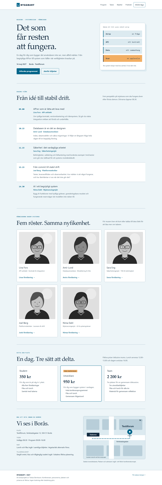
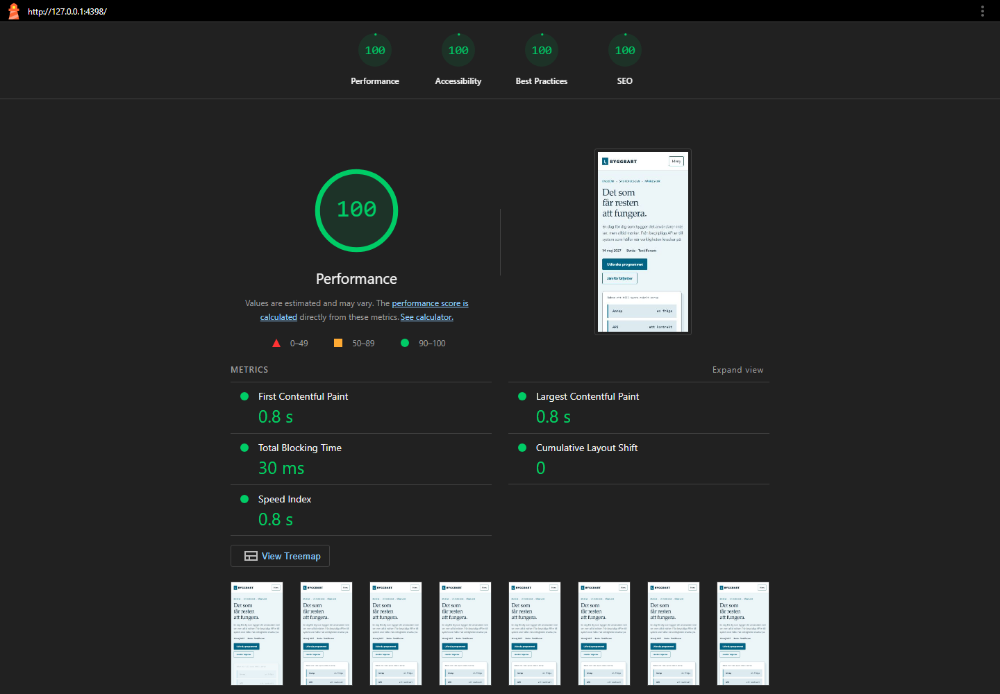

# Byggbart — backendkonferens

En responsiv, fiktiv konferenswebbplats av Tobias Berntsson för BCU26D, HTML & CSS.

- [Webbplats](https://tobernt.github.io/Byggbart/)
- [Källkod](https://github.com/Tobernt/Byggbart)



## Innehåll och teknik

Fem programpunkter, fem illustrerade talare, tre biljettnivåer och praktisk information
med en statisk översiktskarta. Konferensen, personerna, platsen och priserna är fiktiva.

HTML beskriver sidans innehåll och struktur. Tailwind kompilerar CSS lokalt; egna BEM-klasser
finns i `@layer components`. Grid används för program och kort, Flexbox för navigation.
JavaScript förbättrar mobilmenyn och sparar temaval. Kärninnehållet fungerar utan JavaScript.

- `:hover` och `:focus-within` visar samma information på talarkorten.
- Syskonselektorn `+` och `:nth-child(even)` organiserar programmet.
- Attributselektorn `[data-featured='true']` och `::before` markerar en biljettnivå.
- Färger styrs av CSS-variabler och `prefers-color-scheme`.
- Animationer respekterar `prefers-reduced-motion`.
- Bilder är egna SVG-illustrationer med alt-text och dimensioner.
- Synlig fokusmarkering, sidankare och en hoppa-till-innehållet-länk stöder tangentbordsnavigering.

## Kör lokalt

Node.js 22 eller senare:

```sh
npm ci
npm run build
npm start
```

Webbplatsen öppnas på `http://127.0.0.1:4398/`. `Starta konferensen.cmd` kan också användas.
`redovisning.html` är ett lokalt övningsverktyg med manus och timer. Portfoliolänken där
fungerar om `SoftwareEngineerPortfolio` ligger bredvid projektmappen.

## Verifiering

```sh
npm run validate
npx playwright install chromium
npm test
```

Åtta webbläsartester kontrollerar innehåll, lokala resurser, mobilmeny, tema, tangentbord,
reducerad rörelse och layout vid 320, 768, 1024 och 1440 pixlar. axe kontrollerar båda teman.
HTML-validering och Prettier ingår i verktygen. Konfiguration finns i repot.



[Lighthouse-rapport](docs/evidence/lighthouse.html), [mobilvy](docs/evidence/mobile.png),
[mörkt tema](docs/evidence/dark.png).

## AI-process

OpenAI Codex användes som stöd för kravanalys, HTML/CSS-utkast, SVG-illustrationer och tester.
Arbetet utgick från ett backendtema med tydlig innehållshierarki. Lösningen granskades med
HTML-validering, tangentbordsprov, responsiva tester och Lighthouse. Källan i `src/styles.css`
visar de egna selektorerna och layoutbesluten. Viktiga lärdomar är att planera tillgänglighet
tillsammans med layout och att kontrollera AI-genererade förslag mot det faktiska beteendet.

## Publicering

GitHub Actions bygger och kontrollerar projektet och publicerar enbart konferensens webbfiler
till GitHub Pages. Utvecklingsverktyg och övningsmaterial ingår inte i den publicerade webbplatsen.
